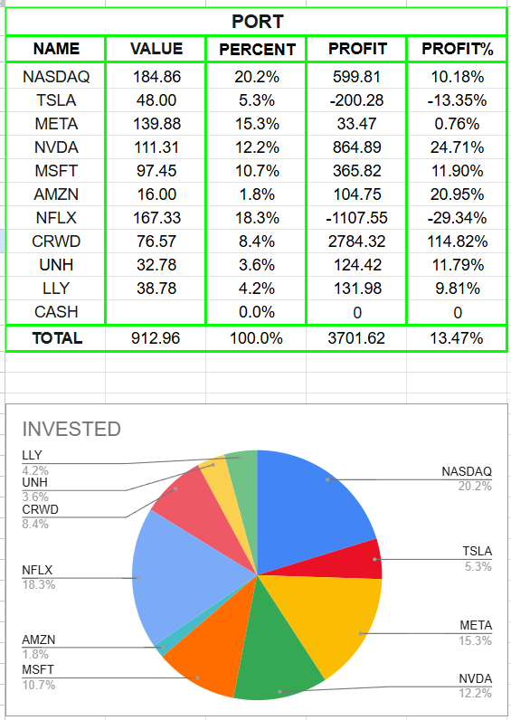
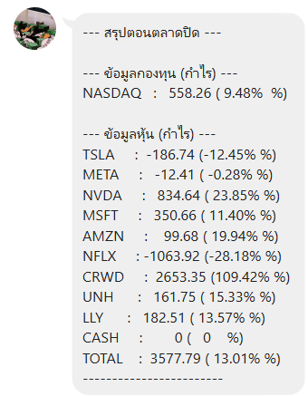

# Stock Portfolio LINE Bot

A personal Python automation project for tracking an investment portfolio through Google Sheets and LINE. It provides on-demand portfolio summaries, allocation charts, and a separate push notification script. The project demonstrates Python automation, REST API integration, Google Sheets integration, webhook handling, and environment-based configuration.

## Project Preview



Google Sheets acts as the portfolio data source and summary dashboard.

## Features

- Request profit, allocation, and invested amount summaries from the Google Sheets worksheet named `Summarize` through a LINE chatbot.
- Generate a dynamic allocation pie chart with QuickChart and return it alongside the percentage summary.
- Prepare and push a fund and stock profit summary with a separate automation script.
- Support Thai and English command aliases for the main portfolio queries.
- Verify LINE webhook signatures, skip unsupported event types, and load connection settings from environment variables.

## LINE Bot Preview



Portfolio information can be requested directly through LINE using the commands below.

## Bot Commands

| Commands | Response |
| --- | --- |
| `Profit` / `กำไร` / `สรุป` | Fund and stock profit amounts and percentages, followed by the spreadsheet's TOTAL row. |
| `Percent` / `สัดส่วน` | Portfolio allocation summary and a dynamic pie chart for the fund and stocks. |
| `Invested` / `จำนวนเงิน` | Fund and stock invested amounts, followed by the spreadsheet's TOTAL row. |
| `Menu` / `เมนู` | Available commands and their descriptions. |

English commands are case-insensitive. The Thai greeting `สวัสดี` also returns a greeting and a prompt to view the menu.

## How It Works

```text
LINE text message
  ↓ Flask webhook → Signature verification → Command handling
  ↓ Google Sheets via gspread
  ↓ Portfolio summary + QuickChart URL
  ↓ LINE Messaging API reply
```

The webhook reads the current spreadsheet values for each portfolio request. For allocation queries, it builds a QuickChart image URL from the fund and stock labels and percentages, then sends the text summary and image together.

Separately, `fund_update.py` reads the same `Summarize` worksheet and pushes a profit summary to the configured LINE user. It runs once per invocation; this repository does not implement automatic scheduling.

## Tech Stack

- **Python / Flask** — automation scripts and the HTTP webhook endpoint.
- **gspread / Google Sheets API / python-dotenv** — spreadsheet access and local environment configuration.
- **LINE Messaging API / Requests** — chatbot replies and push messages.
- **QuickChart** — dynamic allocation chart rendering.

## Project Structure

```text
Stock-Portfolio-LINE-Bot/
├── README.md
├── bot.py
├── fund_update.py
├── test_gsheet.py
├── requirements.txt
├── .env.example
├── .gitignore
└── images/
    ├── portfolio-dashboard.png
    └── line-profit-summary.png
```

- `bot.py`: Flask webhook, command handling, spreadsheet queries, and dynamic chart generation.
- `fund_update.py`: One-shot fund and stock profit summary sent through the LINE push API.
- `test_gsheet.py`: Connectivity check that opens `Summarize` and reads sample cell `A3`; it is not an automated unit test suite.

## Setup

1. Clone the repository using its published URL, then enter the project directory:

   ```powershell
   git clone <repository-url>
   cd Stock-Portfolio-LINE-Bot
   ```

2. Create and activate a virtual environment:

   ```powershell
   python -m venv .venv
   .\.venv\Scripts\Activate.ps1
   ```

   On macOS or Linux, use `python3 -m venv .venv` and `source .venv/bin/activate`.

3. Install dependencies and copy the configuration template:

   ```powershell
   python -m pip install -r requirements.txt
   Copy-Item .env.example .env
   ```

   On macOS or Linux, use `cp .env.example .env` for the copy step.

4. Configure these environment variables in your local `.env`:

   ```text
   LINE_CHANNEL_TOKEN
   LINE_CHANNEL_SECRET
   LINE_USER_ID
   GOOGLE_SHEET_URL
   GOOGLE_CREDENTIALS_FILE
   ```

   The webhook uses the channel token and secret; the push script also needs the recipient user ID. All three scripts use the Google Sheets settings.

5. Enable the Google Sheets and Google Drive APIs in the service account's Google Cloud project. Store the service-account JSON locally as `credentials.json`, and set `GOOGLE_CREDENTIALS_FILE` to its location. If you use another filename, add it to `.gitignore` before publishing.

6. Share the spreadsheet with the service-account email. Ensure it contains a worksheet named `Summarize` with the layout documented below.

7. Run the connectivity check, then start the webhook locally:

   ```powershell
   python test_gsheet.py
   python -m flask --app bot run
   ```

   The check contacts Google Sheets and prints the sample cell value. The Flask command starts a local development server; `python bot.py` alone does not start one.

8. For LINE interaction, make the webhook reachable through a public HTTPS endpoint and configure its `/webhook` URL in LINE Developers. The local Flask server alone is not reachable by LINE and is not a production server.

9. To send a one-time profit summary to the configured recipient:

   ```powershell
   python fund_update.py
   ```

   This command accesses Google Sheets and sends a LINE push message. Schedule it separately if recurring updates are needed.

## Security

- Settings and secrets are loaded from environment variables, with `.env` support for local development.
- `.gitignore` excludes `.env`, the current service-account credential file pattern, and `credentials.json`.
- `.env.example` contains placeholders only; never replace them with real credentials in the published repository.
- LINE webhook requests are verified with the channel secret using HMAC-SHA256 before event processing.
- Keep tokens, user IDs, spreadsheet URLs, private keys, and credential files out of published files and screenshots.
- QuickChart receives chart labels and percentages through the generated image URL; use data appropriate for that external service.

## Portfolio Data Layout

All three scripts select the worksheet by its name, `Summarize`, rather than its tab position. The current configuration expects **1 fund, 9 stocks, and 1 cash row**.

| Portfolio entry | Row(s) |
| --- | --- |
| Fund | 3 |
| Stocks | 4–12 |
| CASH | 13 |
| TOTAL | 14 |

Columns are **A: ticker/label**, **B: invested amount**, **C: allocation percentage**, **D: profit amount**, and **E: profit percentage**. Allocation values must be readable as numbers, optionally with a `%` suffix.

The allocation summary and pie chart use rows **3–12 only**, excluding CASH and TOTAL. Profit and invested amount chatbot summaries include the TOTAL row; the push script reports the fund and stocks only. The scripts read spreadsheet values rather than calculating portfolio totals or fetching market prices.

## Limitations

- Portfolio counts, row positions, and column mappings are configured in code and depend on the expected `Summarize` structure.
- Working LINE and Google service-account configuration is required; chart rendering also depends on QuickChart.
- No scheduler, deployment configuration, or persistent automated test suite is included.
- This is a personal portfolio tracking and automation project, not financial advice or a trading system.

## Future Improvements

- Detect portfolio rows dynamically and make worksheet configuration more flexible.
- Improve push-script error handling and add automated tests.
- Add chart customization options and document production deployment and optional scheduling.

## Project Context

This personal project was built to explore Python automation, API integration, Google Sheets, and LINE bot development through a practical portfolio tracking workflow.
